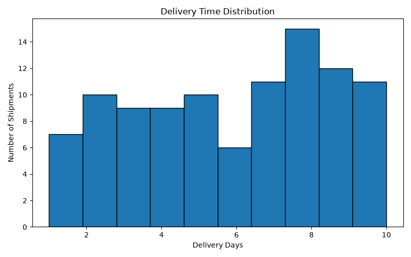
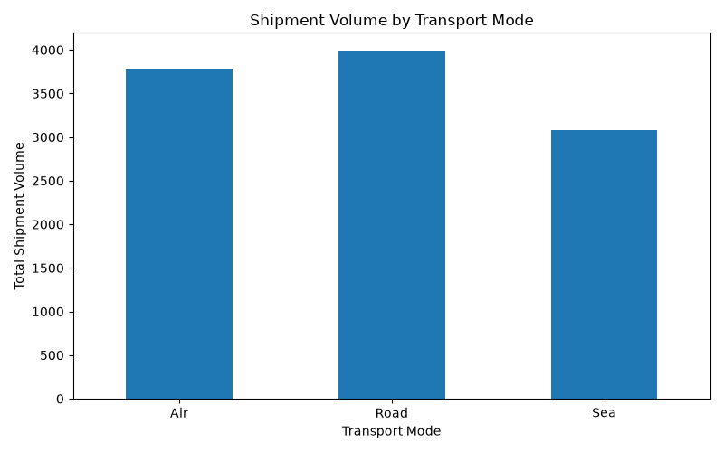
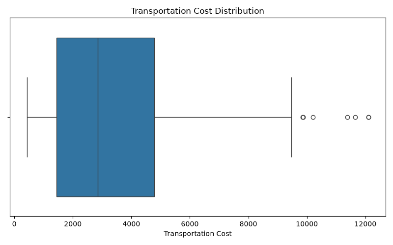
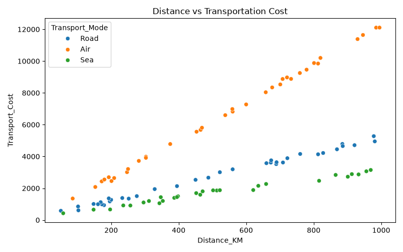
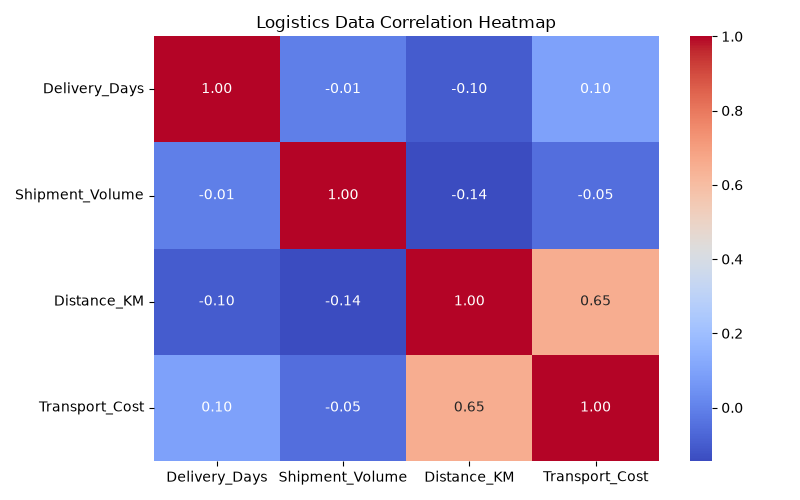

# Logistics-Demand-Forecasting
Data Science project for inventory demand forecasting and logistics optimization using Python.

## Repository Structure

```text
Logistics-Demand-Forecasting/
│
├── week1/
│   ├── main.py
│   └── sample_sales_data.csv
│
├── week2/
│   └── week2_data_preprocessing.py
│
├── week3/
│   ├── week3_advanced_analysis.py
│   ├── logistics_dataset.csv
│   ├── delivery_time_histogram.png
│   ├── shipment_volume_bar_chart.png
│   ├── transport_cost_boxplot.png
│   ├── distance_cost_scatterplot.png
│   └── correlation_heatmap.png
│
├── week4/
│   ├── week4_predictive_modeling.py
│   ├── week4_logistics_dataset.csv
│   ├── delivery_predictions.csv
│   └── model_performance_results.csv
│
├── README.md
└── requirements.txt
```

## Technologies Used

- **Programming Language:** Python
- **Data Analysis:** Pandas, NumPy
- **Data Visualization:** Matplotlib, Seaborn
- **Machine Learning:** Scikit-learn
- **Development Environment:** Visual Studio Code
- **Version Control:** Git and GitHub

## Project Learning Outcomes

- Understanding logistics data and demand forecasting.
- Performing data cleaning and preprocessing.
- Conducting exploratory data analysis.
- Creating meaningful data visualizations.
- Building and evaluating machine learning models.
- Understanding predictive analytics in logistics operations.

## Project Overview
This project demonstrates a simple logistics demand forecasting system. It analyzes product sales data, calculates important KPIs, and predicts the next day's demand using a 7-day moving average.

## Objectives
- Analyze product sales data.
- Calculate product-level KPIs.
- Understand daily demand patterns.
- Generate basic demand forecasts.
- Support better inventory planning.

## Technologies Used
- Python
- Pandas
- Matplotlib
- CSV Dataset

## Project Files
- main.py – Main Python application.
- sample_sales_data.csv – Illustrative sample sales dataset.
- requirements.txt – Required Python libraries.

## KPIs
- Total Units Sold
- Average Demand
- Total Sales Revenue

## How to Run

1. Install Python.
2. Install the required libraries:

   pip install -r requirements.txt

3. Run the application:

   python main.py

## Output
The project generates:
- Product KPI report.
- Next-day demand forecast.
- Daily demand visualization.

Generated files are saved in the outputs folder.

## Dataset Note
The included dataset is synthetic sample data created for demonstration purposes. It does not represent actual company or customer information.

## Future Improvements
- Use real logistics datasets.
- Implement machine learning forecasting models.
- Add inventory optimization.
- Develop an interactive dashboard.

## Conclusion
This project demonstrates how data analysis and demand forecasting can support inventory planning and logistics decision-making.


## Week 2: Data Collection, Cleaning, and Preprocessing

### Objective
To prepare logistics data for analysis by identifying and handling data quality issues.

### Tasks Completed
- Created a sample logistics dataset.
- Identified missing values.
- Handled missing numerical values using median imputation.
- Removed duplicate records.
- Corrected data types.
- Standardized categorical values.
- Detected outliers using the IQR method.
- Applied Min-Max normalization.

### Tools Used
- Python
- Pandas
- NumPy
- Scikit-learn

### Output
Generated a cleaned logistics dataset named `week2_cleaned_logistics_data.csv`.

### Project File
`week2_data_preprocessing.py`

Note: The project uses simulated sample data for demonstration.


## Week 3: Advanced Data Analysis and Visualization in Logistics

### Objective
To perform advanced exploratory data analysis (EDA) on logistics shipment data and create visualizations to identify important patterns, relationships, and trends.

### Tools and Technologies
- Python
- Pandas
- NumPy
- Matplotlib
- Seaborn

### Implementation
- Generated a sample dataset containing 100 shipment records.
- Analyzed delivery days, shipment volume, distance, transportation cost, and transport mode.
- Calculated statistical measures such as mean, median, and mode.
- Examined correlations between numerical variables.
- Identified delivery status and transportation patterns.
- Created five visualizations to understand the dataset.

### Visualizations
1. Delivery Time Histogram
2. Shipment Volume Bar Chart
3. Transportation Cost Boxplot
4. Distance vs. Cost Scatter Plot
5. Correlation Heatmap

### Key Findings
- Total shipment records analyzed: 100.
- Average delivery time: 5.91 days.
- Average shipment volume: 108.69.
- Average distance: 514.62 KM.
- Average transportation cost: 3795.76.
- Successfully delivered shipments: 62.
- Delayed shipments: 38.
- Road transport was the most frequently used mode.
- Distance and transportation cost showed a positive correlation of approximately 0.65.

### Project Outputs
- `logistics_dataset.csv`
- `delivery_time_histogram.png`
- `shipment_volume_bar_chart.png`
- `transport_cost_boxplot.png`
- `distance_cost_scatterplot.png`
- `correlation_heatmap.png`

### Outcome
This task provided practical experience in exploratory data analysis, statistical analysis, data interpretation, and visualization. The findings help understand logistics performance and identify areas where delivery efficiency and transportation costs can be improved.

### Visualization Results
#### 1. Delivery Time Distribution

#### 2. Shipment Volume Analysis

#### 3. Transportation Cost Analysis

#### 4. Distance vs Transportation Cost

#### 5. Correlation Analysis



## Week 4: Predictive Modeling and Optimization in Logistics Systems

### Objective
Develop machine learning models to predict shipment delivery time and evaluate their performance.

### Tools and Technologies
- Python
- Pandas and NumPy
- Scikit-learn
- Linear Regression
- Random Forest Regression

### Implementation
- Generated a dataset containing 200 shipment records.
- Prepared input features and target values.
- Split the dataset into 80% training and 20% testing.
- Trained Linear Regression and Random Forest models.
- Evaluated both models using MAE, RMSE, R² score, and 5-fold cross-validation.

### Results
- Linear Regression MAE: 0.655
- Linear Regression RMSE: 0.843
- Linear Regression R²: 0.771
- Random Forest MAE: 0.759
- Random Forest RMSE: 0.986
- Random Forest R²: 0.686

Linear Regression achieved better performance on the generated dataset.

### Output Files
- week4_logistics_dataset.csv
- model_performance_results.csv
- delivery_predictions.csv
